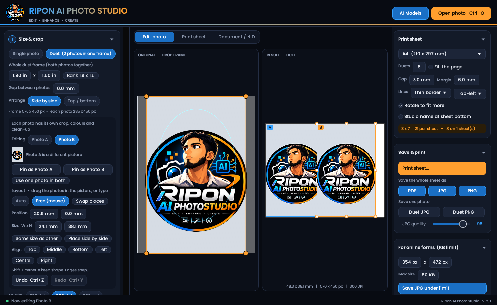
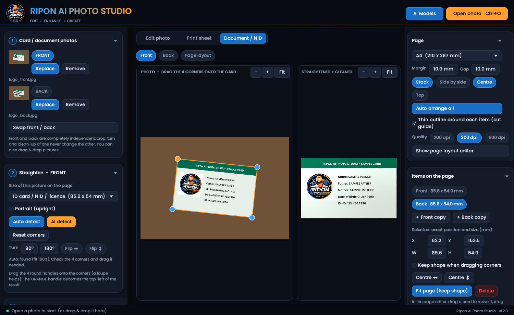

# rust.riponaistudio — Ripon AI Photo Studio

A fast, offline passport / ID photo studio for Windows, written in Rust.
Everything for one photo happens on **one page**: background removal, head crop, enhance, retouch,
print sheets — plus AI upscaling, face restore and an ID-card (NID) scanner-style tool.

No Python, no GPU, no extra DLLs. One `.exe`.
## Screenshots

<p align="center">
  
  
</p>

## Features

**Passport / ID photo**
- AI background removal (U2Net / Silueta, runs locally) with edge refine and a **Restore / Erase brush**
- Auto head detection and crop to the chosen size (passport, visa, custom mm), rotate / straighten
- **Duet** mode: two photos in one frame (e.g. 1.9 x 1.5 in bank size)
- Auto colour and light, brightness / contrast, sharpen, denoise, skin smooth, spot heal, B&W
- Dress / suit overlay (your own transparent PNGs), name and date under the photo
- Print sheets on A4 / 4R / 5R / A3 / Letter / custom — most copies per page, cut marks, PDF / JPG / PNG
- "JPG under N KB" for online forms

**AI Enhance** (optional models)
- Upscale x4 / x2: SPAN, ClearReality, UltraSharp, Real-ESRGAN
- Face restore: GFPGAN 1.4 / 1.2, CodeFormer
- Works on the crop area, with Undo

**Document / NID tool**
- Open the front and back of a card, the card is found and straightened (perspective correction)
- **Manual 4-corner crop** with a loupe when the automatic detection is wrong
- Clean-up (even light, levels, contrast, sharpen, grey / scan B&W), optional AI clear
- Both sides at real size (85.6 x 54 mm) on one A4 page, ready to print

**AI Models manager**
- Models are kept in `%LOCALAPPDATA%\RiponComputer\models\` (same layout as the Ripon Computer Python app)
- Download, import a file, delete, per-model status
- **Editable download links** (several per model, tried in order) — release links expire, so you can paste a new one
- **Backup / restore** all models and links as a `.zip`

## Download

**[Download the latest installer (Windows 10 / 11)](https://github.com/thestartinglightofearth/Ripon-AI-Photo-Studio-Rust/releases)**
— get `rust.riponaistudio-Setup-<version>.exe` from the *Assets* list.

## Install

Run the downloaded setup file.
AI models are *not* inside the installer: open **AI Models** in the app and press Download
(about 42 MB for the small background model; the others are optional).

## Build from source

Requirements: Rust (MSVC toolchain) on Windows 10 / 11.

```
cargo build --release
```
Result: `target\release\ripon-ai-photo-studio.exe`.
`build_installer.bat` also builds the Setup file (needs Inno Setup 6). A GitHub Action
(`.github/workflows/build-windows.yml`) builds the exe and installer for you.

## Usage in short

1. **Open photo** (or drag & drop). Background is removed and the head is placed automatically.
2. Fine-tune the orange crop frame, fix edges with the brush, adjust enhance / retouch.
3. Choose paper and copies on the right, then **Print sheet** (opens a PDF — print at "Actual size / 100%")
   or save PDF / JPG / PNG.
4. For ID cards use the **Document / NID** tab.

## Notes

- Tested with unit tests, a headless self-test and the GUI under Linux. The Windows exe,
  real printers and antivirus / proxy environments depend on your machine.
- Real-ESRGAN is the best-quality upscaler but slow on the CPU; SPAN is fast.
- Face restore expects a roughly frontal face (passport style).

## Model credits and licences

Models are downloaded from their original release pages and are **not** part of this repository.
Check each licence before commercial use — for example CodeFormer is released for non-commercial use.
- U2-Net, Silueta: via [rembg](https://github.com/danielgatis/rembg)
- GFPGAN, CodeFormer, Real-ESRGAN, SPAN and other upscalers: ONNX conversions from
  [facefusion-assets](https://github.com/facefusion/facefusion-assets)
- Inference: [tract](https://github.com/sonos/tract) (pure Rust ONNX). GUI: [egui / eframe](https://github.com/emilk/egui).
- Font: Poppins (SIL Open Font License).

---

© Ripon Computer
